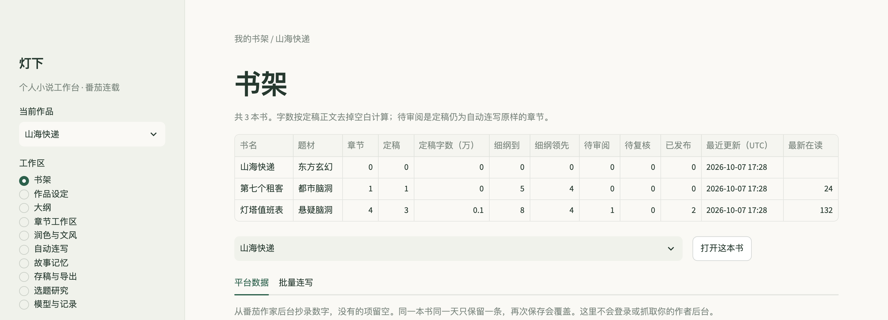
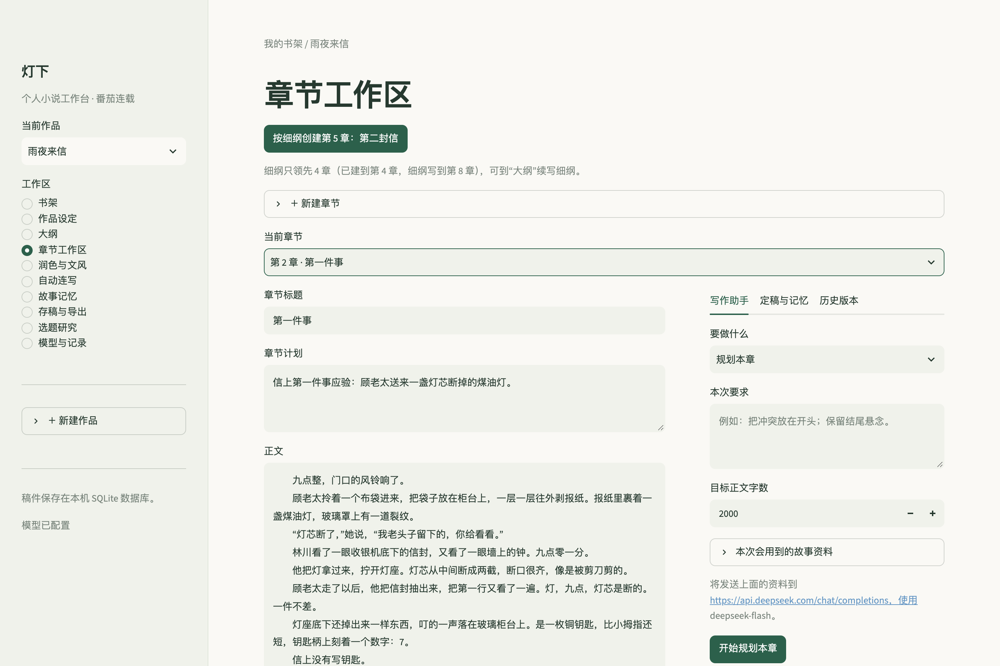
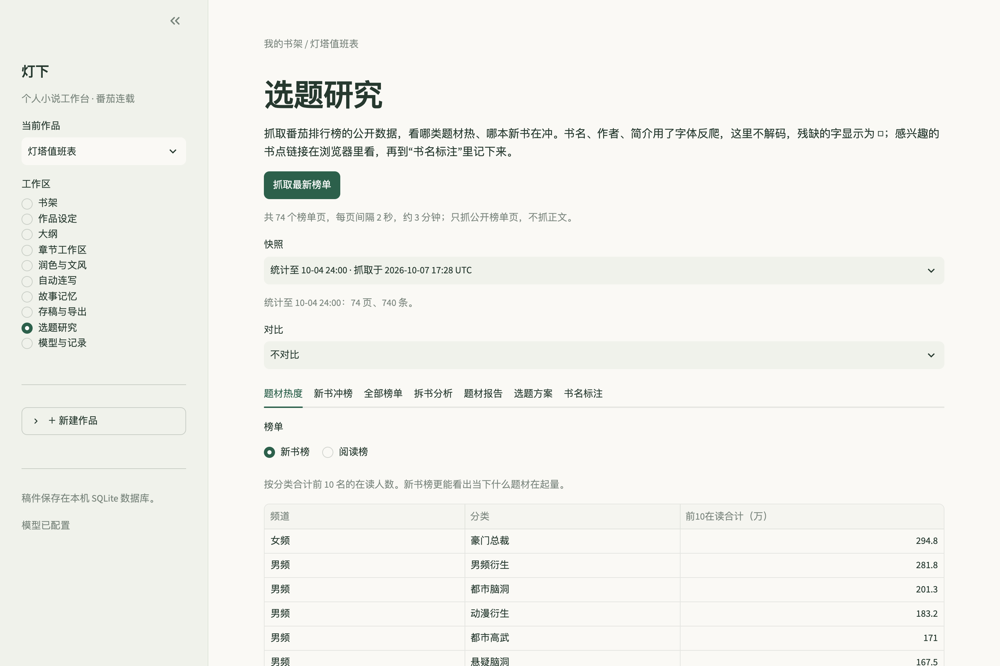
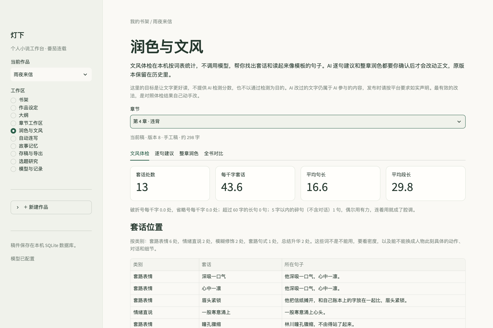
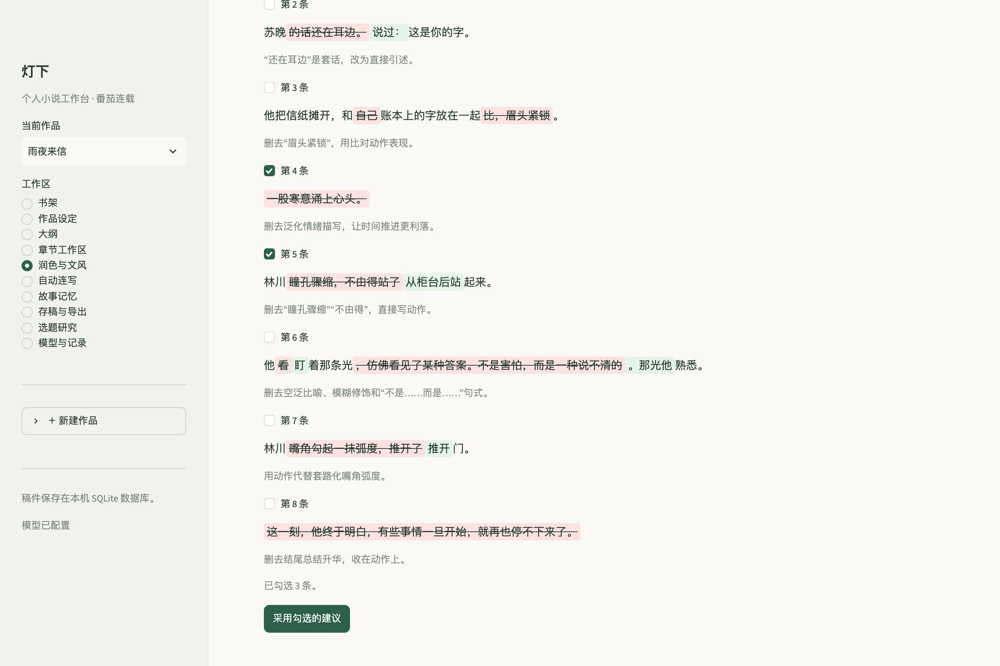

# 灯下 · 小说工作台

[](https://github.com/ysy2003/novel-workbench/actions/workflows/tests.yml)

用于自己写小说并在番茄连载的本地工具。作品、章节版本、人物与剧情记忆保存在 SQLite；没有模型密钥也能开书、写作、定稿和导出。

## 界面截图

截图使用示例数据：书目和正文是为演示编写的；榜单是 2026-10-04 抓取的番茄公开数据，只显示分类合计。

**书架**：几本书的章节、定稿、细纲进度、待审阅和最新在读人数。



**章节工作区**：章节计划和正文，右侧是写作助手（规划、初稿、改写、一致性检查、提取记忆）。



**选题研究**：按分类合计番茄排行榜前 10 名的在读人数。



**润色与文风 · 文风体检**：本机按词表找出套话，标出所在句子。



**润色与文风 · 逐句建议**：模型给出的修改建议，红色划线是删去的文字，绿色是新加的文字；勾选后才保存为新版本。



## 启动

需要 Python 3.11+。macOS 可以运行 `start.command`，它会在项目 `.venv` 中安装锁定依赖，然后启动本机服务。启动后打开 <http://127.0.0.1:8501>；在终端按 Ctrl+C 停止。若端口已被当前预览占用，请先关闭旧服务，或设置 `NOVEL_PORT=8502`。

也可以在项目目录执行：

```bash
python3.11 -m venv .venv
source .venv/bin/activate
python -m pip install -r requirements.lock.txt
python -m streamlit run app.py
```

Windows 使用 `py -3.11 -m venv .venv`，随后用 `.venv\Scripts\python -m pip install -r requirements.lock.txt` 和 `.venv\Scripts\python -m streamlit run app.py`。

## 第一次使用

1. 输入书名、创意，创建作品；题材可以暂时留空。
2. 在“作品设定”里维护人物、世界规则、大纲和文风。
3. 在“大纲”里建立分卷（卷名、章节范围、卷大纲），在表格里写每章细纲，或用“AI 续写细纲”一次生成后续若干章，采用后才写入。总纲（全书主线、暗线、伏笔表）仍在“作品设定”的故事大纲里。
4. 在“章节工作区”新建章节：下一章有细纲时，可以点“按细纲创建”，标题和计划自动带入；也可以手动填写计划与正文。离开输入框时保存版本；关闭浏览器前确认显示“已保存”。显式保存按钮也可使用。
5. 想连续写多章时，用“自动连写”：从下一章起按细纲自动规划、写初稿、检查（字数、“作者备注”泄露、输出完整、记忆格式）、提取记忆并定稿，一次最多 10 章，任何一步不通过就停下，已写完的章节保留。只写新章节，不改已有章节；页面列出定稿仍是自动原样的章节，方便抽查。默认开启“细纲不够时自动续写”：每写一章前，如果从这一章起连续细纲不足 4 章，就续写 10 章细纲并直接采用（只填空位、不超出分卷；当前章已有细纲时续写失败只提醒、继续写；细纲中间有空洞时停下）。
6. 需要 AI 时，在“写作助手”选择规划、初稿、改写、检查或记忆提取。可先查看将发送的资料。结果先进入候选稿，点击采用后才改变当前稿。
7. 在“定稿与记忆”填写或修订摘要和事实，点击“确认记忆并定稿”。没有 API 时，直接手工填写即可。
8. 创建下一章，系统使用前文已确认的事实和最近 6 章摘要。修改旧章并重新定稿后，后续章节记忆会标为待复核。这只是提醒，不影响续写、定稿和导出；核对后在“定稿与记忆”里再次确认即可。
9. 在“存稿与导出”下载单章 TXT 或定稿 ZIP。标题和正文分别填到番茄后台，后台确认后手工记录发布状态。这里不会自动登录或提交到番茄。

## 书架与多开

侧边栏第一项“书架”：

- 总览：每本书的章节、定稿、定稿字数、细纲进度、待审阅（定稿仍是自动连写原样）、待复核、已发布章数、最近更新和最新在读人数；可以直接打开某本书。
- 平台数据：从番茄作家后台抄录在读人数、加书架、追读人数、完读率、收入，没有的项留空；同一本书同一天一条，各书最新数据并排显示，括号里是与上一条相比的变化。这里不登录、不抓取作者后台。
- 批量连写：选几本书，每本连写若干章，依次执行；规则与“自动连写”相同，某本书不满足前提就跳过并说明原因。

## 润色与文风

侧边栏“润色与文风”，选一章：

- 文风体检：本机按词表统计，不调用模型。标出套路表情（嘴角勾起一抹弧度、眼中闪过一丝、顿了顿）、否定描写（没动、没回头、没出声）、情绪直说、模糊修饰（仿佛、似乎、一丝）、总结升华、套路句式，每处附所在句子；另有每千字密度、破折号和省略号密度、平均句长和段长、长句、碎句、同章重复词组。“全书对比”按章列出这些数据和当前稿来源。词表在 `novel/polish.py` 的 `PATTERNS`，可以自行增删。
- 逐句建议：模型返回逐条修改建议（原句、改为、理由），页面用红色划线和绿色标出改动。勾选要采用的，点“采用勾选的建议”后保存为新版本；原句在正文里找不到、出现多次或正文已改过的建议不能采用。
- 整章润色：轻度润色、去套话或自定义要求，结果是候选稿，逐段对比后再决定是否采用。

这里只为让文字更好读，不提供 AI 检测分数，也不以通过检测为目的。AI 改过的文字仍属于 AI 参与的内容，发布时请按平台要求如实声明。已定稿的章节改完后，回“章节工作区”重新定稿，导出用的是定稿。

## 选题研究

侧边栏“选题研究”抓取番茄排行榜的公开数据：男女频 × 新书榜/阅读榜 × 各分类，共 74 页、每页前 10 名，每页间隔 2 秒，约 3 分钟。番茄 robots.txt 允许抓取；只抓公开榜单页，不抓正文。书名、作者、简介用了字体反爬，这里不做解码，残缺的字显示为 □，可以点链接在浏览器里看，再在“书名标注”里记下书名、标签和备注。

- 题材热度：按分类合计前 10 名在读人数，有上一份快照时显示变化。
- 新书冲榜：同一本书在两份快照之间的在读增长、名次变化、新增章节，新上榜的单独标出。
- 全部榜单：按频道、榜单、分类查看。

排行榜每天下午 3 点前更新上一日数据，每天抓一次即可；增长类分析需要至少两天的快照。

拆书分析：在“拆书分析”里选一个榜单分类，抓取这一页 10 本书的详情页（书名、标签、字数、简介、完整目录都是正常文字，没有字体遮挡），再批量生成分析卡：为什么火、书名套路、简介写法、开篇钩子、核心卖点、设定亮出、主角人设、冲突结构、爽点分布、章末钩子、节奏、可借鉴、不可照搬。可以附上你合法拿到的正文或阅读笔记作为补充样本；补充样本只发送给模型，不写入数据库。

题材报告：同一分类有 2 张以上分析卡时，在“题材报告”里横向对比，输出共同卖点、书名公式、人设模板、开篇规律、爽点节奏、差异化空间和新书建议。

选题方案与开新书：在“选题方案”里选一份题材报告，填上你的偏好（可选），生成 3 个差别明显的方案（至少一个主流爽点路线、至少一个差异化路线）。选中一个生成开书草稿：故事创意、人物与世界设定、总纲（含作者用的暗线和伏笔表）、写作偏好、第一卷大纲。草稿显示在可编辑的表单里，你改完点“用这份草稿创建作品”才会建书和第一卷，之后到“大纲”续写细纲、用“自动连写”写正文。只借鉴结构和节奏，不用现有作品的书名、人物、桥段，不写同人。

分析卡、题材报告、选题方案、开书草稿的模型输出解析失败时，原始输出保存在“模型与记录”页底部，方便查原因。

## 模型接入

将 `.env.example` 复制为 `.env`，在本机填写服务商的**完整请求 URL**、模型名称和 API 密钥，然后重启应用：

```dotenv
NOVEL_API_URL=https://你的服务商/完整路径/chat/completions
NOVEL_MODEL=服务商提供的模型名称
NOVEL_API_KEY=真实密钥仅在本机填写
NOVEL_API_TIMEOUT=120
NOVEL_MAX_OUTPUT_TOKENS=8192
NOVEL_PLAN_REASONING=low
```

`NOVEL_PLAN_REASONING` 只影响“规划本章”（包括自动连写里的规划）：`low`/`high`/`max` 发送顶层 `reasoning_effort`，`off` 用 DeepSeek 的 `thinking` 字段关闭思考，留空则不发送。2026-10-02 用 deepseek-flash 实测同一份第 5 章规划请求：默认 15.8 秒（思考 1384 tokens），low 8.9 秒（378），off 6.9 秒（0），计划结构与质量相近；默认模式波动大，连写时曾出现单次 60–90 秒。

当前实现的是 Chat Completions 协议：Bearer 密钥、`model/messages/stream/max_tokens` 请求，以及 `choices[0].message.content` 响应。服务商必须支持此协议与这些参数；其他协议要增加适配器。没有预设服务商、默认模型或付费调用。提示词、返回结果和服务返回的 token 用量保存在本地调用记录中；密钥不入库。

接口格式参考 [DeepSeek 官方调用文档](https://api-docs.deepseek.com/)，这只是协议参考，其他兼容 Chat Completions 的服务也可以接入。已用 DeepSeek 的 deepseek-flash 实测写作、连写、拆书和润色，记录见 `docs/project.md`；写作效果仍需作者自己判断。失败请求不自动重试，以免重复计费；超时后可能仍产生服务端用量。模型输出截断会保留供查看，但不会直接变成可采纳的完整候选稿。

## 保存与恢复

- 默认数据库：`data/novels.sqlite3`。可通过环境变量 `NOVEL_DB_PATH` 指定其他本地路径。
- 版本是追加保存的；恢复历史版本会新建一个当前稿，历史仍保留。
- AI 候选稿不会自动覆盖手工稿；只有定稿进入正式记忆。
- 在“存稿与导出”下载数据库备份。恢复时先关闭应用，另存现有数据库，再将备份复制到数据路径，重新启动。
- 定稿 ZIP 包含逐章 TXT，UTF-8 BOM 编码，文件名按数字排序。生成压缩包和记录导出不意味着平台已发布。
- 修改正在输入但尚未失焦的文字还没有提交到服务端；不要在此时直接关掉浏览器。

## 第一版范围

已实现：开书、设定编辑、章节计划、正文版本与恢复、模型任务与候选稿、精确局部改写、带来源的结构化记忆、旧章重定稿后的记忆失效、定稿导出、人工发布记录与数据库备份。

续写上下文包括：本章标题、计划、作者要求、正文和最近 6 章摘要里提到的对象的全部事实，最近 3 章更新的事实（含待复核章节）、最近 6 章摘要，以及上一章定稿版本的结尾约 500 字（从段落开头截取）。另外附上本卷大纲、本章细纲和后续 3 章细纲，以及各卷的卷名和范围。事实部分有 12000 字符预算，超出时优先保留被提到对象和较新的事实；发送了多少、省略了多少会在发送前显示，也会告诉模型。设定、大纲等合计超过 60000 字符时提示缩减。尚未加入向量检索、自动上传、多设备同步、全文训练或自动整本创作。题材与章节目标字数由用户自行设置。

## 开发与验证

```bash
python -m pytest -q
python -m compileall -q app.py novel
```

每次推送到 main 或提交 PR 时，GitHub Actions 会在 Python 3.11 和 3.13 上安装锁定依赖、做编译检查并运行全部测试（`.github/workflows/tests.yml`），不需要模型密钥。存储测试使用真实临时 SQLite，界面流程使用 Streamlit AppTest，模型协议测试使用 HTTP 模拟传输。这些测试覆盖工程行为，不能证明小说质量或平台接收情况。具体检查结果和后续任务见 `docs/project.md`。

## 许可证

[MIT](LICENSE)
